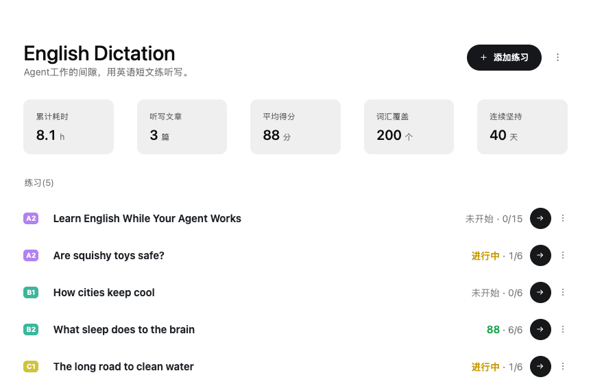
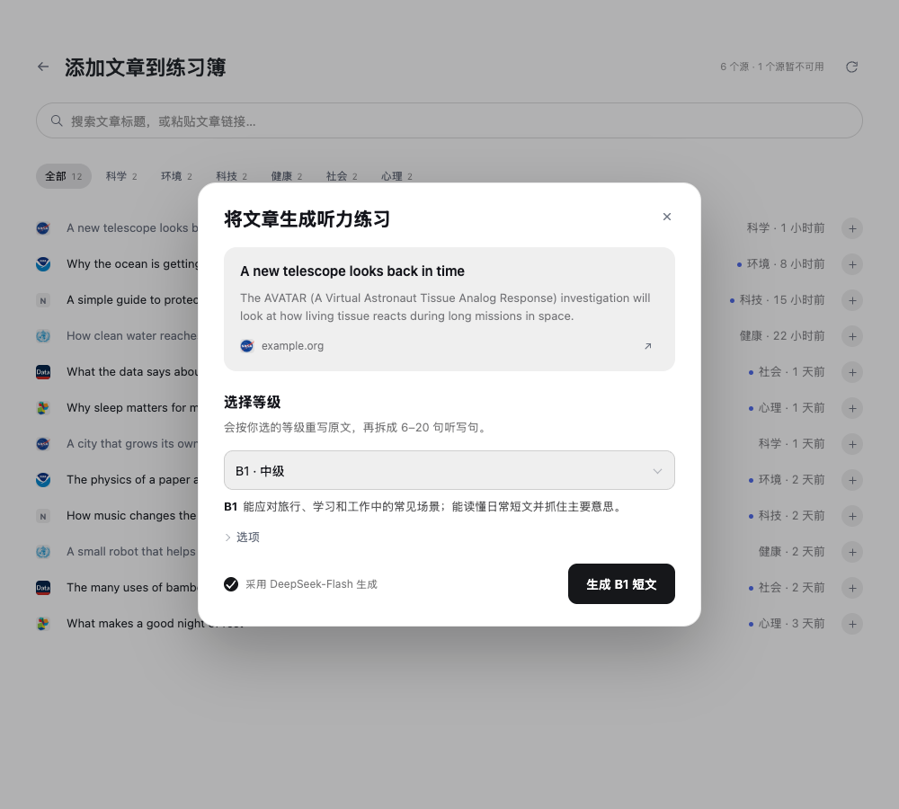
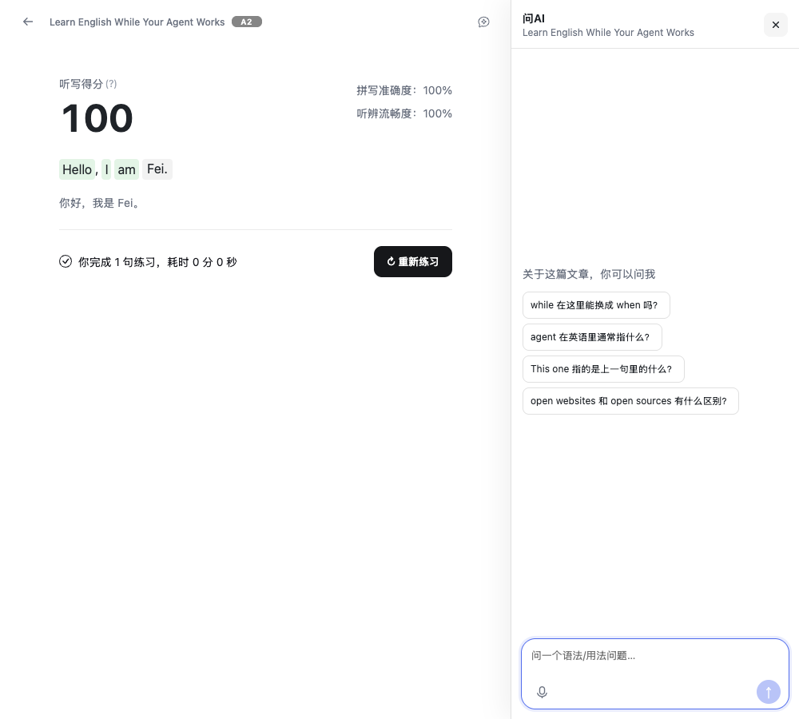

# 英文听写 · English Dictation

> 在 Agent 工作的间隙，用一篇短文练英语听写。

这是一个给 [DeepSeek Harness](https://github.com/deepseek-harness) 用的英语听写插件。它会把 NASA、WHO、Our World in Data 等公开文章，改写成适合你当前等级（A1–C2）的短文，让你逐词听写，并在结束后给出分数和 AI 答疑。



## 适合谁

- 想利用 Agent 跑任务的几分钟练英语，而不是刷单词；
- 喜欢整句听写、逐词纠错，而不是选择题；
- 想按自己的水平（A1–C2）读真实题材的短文；
- 需要有人解释「这里为什么用 when 不用 while」。

## 功能

- **文章变练习**：从公开文章生成整篇听写练习，每个词一个输入框；
- **按水平改写**：A1–C2 可选，按句法和词汇控制难度；
- **逐词判分**：拼写准确度 + 听辨流畅度，完成整篇后有总分；
- **AI 答疑**：结束后可直接问语法、词汇、指代、翻译问题；
- **本地进度**：断点续练、练习档案、历史分数都存在本机；
- **语音朗读**：Edge 在线语音优先，失败时回退系统语音。

## 安装

### 通过 DSH 插件市场（推荐）

1. 打开 DSH 的 **插件** 页面；
2. 进入 **更多 / 实验性插件**，开启 **自定义插件市场**；
3. 在 **发现 → 添加索引源** 中填写：

   ```text
   https://raw.githubusercontent.com/brickhu/dsh-plugins/main/market/index.json
   ```

4. 搜索「英文听写」或「English Dictation」，安装；
5. 重启 DSH，刷新页面，左侧栏会出现 **英文听写**。

> 需要 DSH `>=0.2.2-rc.1 <0.3.0`。

### 通过 npm

适合手动管理插件或二次开发：

```bash
npm install dsh-english-dictation
```

安装后在 DSH 的插件管理器里启用。普通用户建议走上面的插件市场。

## 第一次使用

第一次打开会自带一篇 A2 首练 **Learn English While Your Agent Works**，不需要先添加文章：

1. 点练习行右侧箭头开始；
2. 先听整句，再在下方输入框里逐词拼写；
3. 做完当前句按 `Enter` 看结果，再按一次进入下一句；
4. 整篇完成后查看得分，或打开右侧 **问AI** 继续提问。

之后可以在首页点 **添加练习**，选一篇新文章。

## 首页

- **五个统计卡**：累计耗时、听写文章、平均得分、词汇覆盖、连续坚持；
- **练习列表**：每行显示等级、标题、状态和进度；完成过的文章会显示得分；
- **继续练习**：点行尾箭头，从上次中断的句子继续；
- **语音设置**：右上角 `⋮` → 语音，选择音色、语速并试听；
- **学习档案**：查看已移除练习的来源，重新生成。

练习行右侧的 `⋮` 可以 **移除练习**。移除不会丢来源：以后可在学习档案里用同一篇文章、同一等级重新生成。

## 添加文章



- 文章来自 NASA、NOAA、NIST、WHO、Our World in Data、PLOS ONE、Frontiers 等公开来源；
- 可以按话题筛选、按标题搜索；
- 也可以直接粘贴一个公开文章 URL，让插件抓取正文；
- 点 `+` 选择这次生成的等级（默认上次选的等级）；
- 在「选项」里可以单独设置这篇文章的语音和语速；
- 生成完成后直接加入练习列表，不会跳走；失败会提示原因，文章仍留在列表里。

生成使用 DSH 当前配置的模型，不需要额外填写 API Key。

## 听写

进入练习后：

- 上方是当前句的中文翻译；
- 下方每个单词一个输入框，标点已经印在框旁边，不用输入；
- 人名、地名、机构名等专有名词和数字直接显示，不参与拼写；
- 输入框下方的小灰点表示这个词还剩几个字母。

### 快捷键

| 操作 | 作用 |
|---|---|
| 字母键 | 输入当前单词 |
| `Space` | 跳到下一个词；在最后一个词上等于检查 |
| `Enter` | 检查当前句；结果页再按一次进入下一句 |
| `Alt` / `Option` | 重听当前句；播放中暂停/继续 |
| `↑` | 按住查看当前词；**空白框查看算一次错误**，已输入正确时不计错 |
| `←` / `→` | 在词首/词尾时跳到相邻单词 |

底部可以切换 `0.5× / 0.8× / 1× / 1.5× / 2×` 语速。

答对后进入结果页；答错时错误的词标红，焦点回到第一个错词，改完再检查。

## 评分

整篇完成后会看到两个维度：

### 拼写准确度

每个可输入词按检查次数给基础分：

| 检查次数 | 基础分 |
|---|---|
| 第 1 次就拼对 | 1.0 |
| 第 2 次拼对 | 0.6 |
| 第 3 次拼对 | 0.3 |
| 第 4 次及以后 | 0.1 |

看词/提示会降低这个词的拼写分；重听影响的是听辨流畅度。空白框直接按 `Enter` 只是标红，不算一次错误；但空白框按 `↑` 看词会算一次错误。同一个错误答案重复提交只算一次。

### 听辨流畅度

由两部分决定：

- **输入期重听次数**：每句第 1 次重听不扣分，之后越多扣得越多；
- **速度**：和你自己同等级最近几篇的每词用时比较。样本不足 3 篇时按正常速度计算。

### 总得分

```text
听写得分 = 拼写准确度% × 听辨流畅度% ÷ 100
```

首页的 **平均得分** 是已完成文章「听写得分」的平均值。

## 结束页与问AI



整篇完成后：

- 顶部显示 **听写得分**、拼写准确度和听辨流畅度；
- 中间是整篇词块（绿色 = 一次通过，琥珀色 = 重试过）和中文翻译；
- 底部显示完成句数、耗时，以及 **重新练习**；
- 右上角 **问AI** 打开侧栏，可以继续问这篇文章里的语法、词汇、搭配、指代和翻译问题。

问AI 的对话按文章保存，换文章会另开一条。

## 语音

- 默认优先使用 **Edge 在线语音**，不需要 API Key；
- 在线语音不可用时回退到系统语音（macOS `say` / 系统 `speechSynthesis`）；
- 音色、语速可以在首页语音设置里改，也可以在添加文章时为单篇单独设置；
- 系统语音不一定支持所有语言和音色，以下拉框里实际可用的为准。

## 数据与隐私

所有练习数据保存在本机：

```text
~/.dsh/storages/dsh-english-dictation/
```

包括文章、进度、得分、语音设置、来源图标和已移除练习的归档信息。

- 生成练习时，文章正文会发送给当前配置的 DSH 模型；
- 使用 Edge 在线语音时，句子会发送给 Edge TTS 服务；
- 不需要注册账号，进度不会上传到第三方；
- 移除练习会删除练习正文和进度，只在归档里保留标题、来源和等级；
- 想彻底清空，可以在 DSH 中删除这个插件的 storage 目录。

## 常见问题

**没有声音？**

先确认首页语音设置里选中的音色可用，并点「试听」。Edge 语音需要网络；网络不可用时切到系统语音。Linux 上系统语音可能没有安装音色。

**生成失败，文章还在吗？**

在。生成失败会弹出提示，文章仍留在添加列表里，可以再点一次；不会留下半篇空练习。

**为什么分数比预期低？**

看词、提示、重复检查和重听都会影响分数。空白框按 `↑` 看词也会直接算一次错误。

**怎么重练？**

完成页底部点 **重新练习**；已在练习列表里的文章，点行尾箭头从断点继续。

**怎么删除练习？**

练习行右侧 `⋮` → **移除练习**。来源会进学习档案，之后可以重新生成。

**支持哪些等级？**

A1、A2、B1、B2、C1、C2。每次添加文章时选择，默认使用上次选的等级。

## 反馈

- 问题与建议：https://github.com/brickhu/dsh-plugins/issues
- 源码：https://github.com/brickhu/dsh-plugins/tree/main/dictation

插件代码使用 MIT License。文章内容版权归原来源，许可证与署名随文章保存；WHO 内容按 CC BY-NC-SA 3.0 IGO 使用，请勿用于商业用途。
